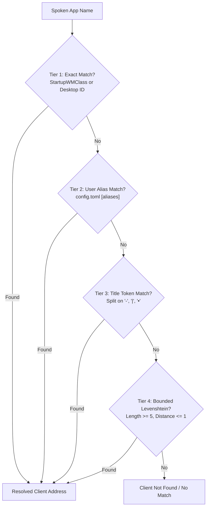
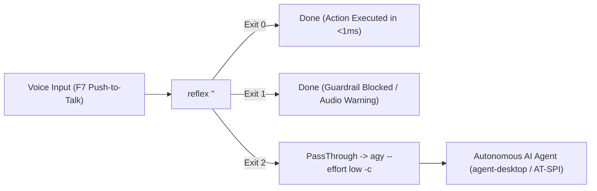

# Reflex: Commands and Capabilities Reference Manual

**Reflex** is a sub-5ms, deterministic, low-latency desktop automation engine written in Rust for Arch Linux running Hyprland, PipeWire/WirePlumber, and QuickShell.

This document serves as the exhaustive, single-source-of-truth reference for all supported voice/CLI commands, natural language variants, 4-tier application resolution, safety guardrails, synthesized earcons, and system integration.

---

## 1. Quick Start & Execution Modes

### Push-to-Talk Keybinds (`~/.config/hypr/custom/keybinds.lua`)
- **Hold `F7`**: Speak any desktop command or natural request, release key to execute:
  - If the command matches Reflex deterministic grammar $\rightarrow$ executes instantly (<1ms) with audible earcon feedback.
  - If the command is an open-ended goal or outside deterministic grammar $\rightarrow$ Reflex exits with code `2` (`PassThrough`), instantly handing off the transcript to headless `agy` (`Google Antigravity` + `agent-desktop`).
- **Hold `F8`**: Hex continuous speech dictation (types spoken words directly into the active window via Wayland virtual keyboard).

### Direct CLI Invocations
```bash
# Deterministic command execution
reflex "volume up"
reflex "move YouTube to workspace 4"
reflex "screenshot window"

# Check exit code
reflex "set volume 100" || echo "Exited with code $?"
```

---

## 2. Command Grammar & Capabilities Inventory

All commands support natural phrasing, word or digit numbers (0–100), optional prepositions (`to`, `by`, `in`), and conversational preambles (`please`, `can you`, `could you`).

### 2.1 Audio & Volume Management
Direct control over WirePlumber audio sinks and sources without spawning blocking shell processes.

| Capability | Spoken Variants / Synonyms | Action / AST | Details & Guardrails |
| :--- | :--- | :--- | :--- |
| **Volume Up (Default)** | `"volume up"`, `"louder"`, `"turn it up"` | `AudioAction::VolumeStep(+5)` | Steps volume up by +5%. Enforces +15%/500ms velocity limit. |
| **Volume Down (Default)** | `"volume down"`, `"quieter"`, `"softer"`, `"turn it down"` | `AudioAction::VolumeStep(-5)` | Steps volume down by -5%. |
| **Volume Up by N** | `"volume up by 10"`, `"volume up 15%"`, `"louder by ten"` | `AudioAction::VolumeStep(+N)` | Steps volume by specified percentage $N$. |
| **Volume Down by N** | `"volume down by 10"`, `"volume down 20%"`, `"quieter by five"` | `AudioAction::VolumeStep(-N)` | Decrements volume by specified percentage $N$. |
| **Set Absolute Volume** | `"set volume to 60"`, `"volume 50%"`, `"set volume 40"`, `"volume seventy"` | `AudioAction::VolumeSet(N)` | Clamped to max 80% ceiling and +15%/500ms velocity. |
| **Mute Output** | `"mute"`, `"mute audio"`, `"silence"` | `AudioAction::Mute(true)` | Mutes default audio sink. |
| **Unmute Output** | `"unmute"`, `"unmute audio"` | `AudioAction::Mute(false)` | Unmutes default audio sink. |
| **Toggle Output Mute** | `"toggle mute"` | `AudioAction::MuteToggle` | Toggles output sink mute state. |
| **Toggle Microphone Mute** | `"toggle mic"`, `"mute mic"`, `"unmute mic"` | `AudioAction::MicMuteToggle` | Toggles default microphone source mute state. |
| **Switch Audio Port** | `"switch audio"`, `"switch speaker"`, `"toggle speaker"`, `"toggle audio"`, `"change speaker"`, `"swap audio"`, `"headphones"`, `"switch to headphones"`, `"switch to speaker"` | `AudioAction::SwitchPort` | Cycles physical output port (e.g., Headphones $\leftrightarrow$ Speakers). |
| **Mute Named App** | `"mute brave"`, `"mute spotify"`, `"silence discord"`, `"mute youtube"`, `"mute mpv"` | `AudioAction::AppAudio { target, mode: Mute(true) }` | Discovers PipeWire node ID for app via `pw-dump` and sets mute without stealing window focus (<5ms). |
| **Unmute Named App** | `"unmute brave"`, `"unmute spotify"`, `"unmute discord"` | `AudioAction::AppAudio { target, mode: Mute(false) }` | Unmutes background stream for target app node. |
| **Toggle App Mute** | `"toggle mute brave"`, `"toggle brave audio"` | `AudioAction::AppAudio { target, mode: ToggleMute }` | Toggles mute state of target application audio stream. |
| **Set App Volume** | `"set brave volume 50"`, `"brave volume 70"`, `"volume brave 40"`, `"brave volume to 60"` | `AudioAction::AppAudio { target, mode: VolumeSet(N) }` | Sets target application stream volume directly. |
| **Step App Volume** | `"turn up brave"`, `"brave volume up"`, `"turn down brave"`, `"brave volume down"` | `AudioAction::AppAudio { target, mode: VolumeStep(±5) }` | Increments/decrements target stream volume by ±5%. |

---

### 2.2 Media Playback (MPRIS via D-Bus)
Direct control over active media players (Chromium, Brave, Spotify, VLC, MPV) via asynchronous `zbus` D-Bus calls.

| Capability | Spoken Variants / Synonyms | Action / AST | Details |
| :--- | :--- | :--- | :--- |
| **Play / Resume** | `"play"`, `"resume"`, `"unpause"`, `"play music"`, `"play song"` | `MediaAction::Play` | Sends `Play` method call to all active MPRIS players. |
| **Pause / Stop Media** | `"stop"`, `"pause"`, `"stop music"`, `"pause music"`, `"stop video"`, `"pause video"`, `"stop song"`, `"stop playback"`, `"stop audio"` *(homophone: `"paws"`)* | `MediaAction::Pause` | Sends immediate asynchronous `Pause` method call over D-Bus to all active MPRIS players (<2ms). |
| **Toggle Play / Pause** | `"toggle media"`, `"toggle play"`, `"play pause"`, `"toggle playback"` | `MediaAction::Toggle` | Calls `PlayPause` on MPRIS interface. |
| **Next Track** | `"next"`, `"skip"`, `"next song"`, `"next track"` | `MediaAction::Next` | Skips to next track. |
| **Previous Track** | `"previous"`, `"prev"`, `"last song"`, `"back song"`, `"previous track"` | `MediaAction::Previous` | Rewinds to previous track. |
| **Replay Track** | `"replay"`, `"restart song"`, `"restart track"` | `MediaAction::Replay` | Re-triggers previous track or seeks to 0. |
| **Seek Forward** | `"seek forward 10 seconds"`, `"seek forward five"` | `MediaAction::SeekForward(N)` | Offsets playback position forward by $N$ microseconds. |
| **Seek Backward** | `"seek backward 30 seconds"`, `"seek backward ten"` | `MediaAction::SeekBackward(N)` | Offsets playback position backward by $N$ microseconds. |

---

### 2.3 Workspace Navigation & Window Relocation
Direct compositor control over Hyprland `.socket.sock` with decoupled verification on `.socket2.sock`.

| Capability | Spoken Variants / Synonyms | Action / AST | Details |
| :--- | :--- | :--- | :--- |
| **Focus Workspace** | `"workspace 3"`, `"go to workspace 5"`, `"switch to workspace 2"`, `"switch to 4"`, `"go to 1"` | `WorkspaceAction::Focus(N)` | Dispatches `workspace <N>`. |
| **Move Active Window** | `"move window to workspace 6"`, `"move this window workspace 6"`, `"move to 4"`, `"move this to workspace 2"` | `WorkspaceAction::MoveWindow { workspace: N, follow: false }` | Moves active window to workspace $N$ without shifting user focus. |
| **Move Active Window & Follow** | `"move to 6 and follow"`, `"move window to workspace 3 follow"` | `WorkspaceAction::MoveWindow { workspace: N, follow: true }` | Moves active window to workspace $N$ and switches focus to workspace $N$. |
| **Move Named App to Workspace** | `"move YouTube to 4"`, `"move Chrome to workspace 6"`, `"move Spotify 2"`, `"move WhatsApp to 5 and follow"` | `Action::MoveNamed { app, workspace, follow }` | Uses 4-Tier `AppRegistry` to locate target window by class/alias/title, moves it to workspace $N$. |

---

### 2.4 Window Management & Directional Navigation

| Capability | Spoken Variants / Synonyms | Action / AST | Details & Safety Policies |
| :--- | :--- | :--- | :--- |
| **Focus Direction** | `"focus left"`, `"focus right"`, `"focus up"`, `"focus top"`, `"focus down"`, `"focus bottom"`, `"focus window left/right/up/down"` | `WindowAction::FocusDirection(Dir)` | Switches focus to adjacent window in tiling layout. Supports both `up`/`down` and `top`/`bottom`. |
| **Swap / Move Window Direction** | `"move left"`, `"move right"`, `"move up"`, `"move top"`, `"move down"`, `"move bottom"`, `"move window left/right/top/down"`, `"swap left/right/top/down"` | `WindowAction::MoveDirection(Dir)` | Swaps active window position in tiling layout in the specified direction (<1ms). |
| **Toggle Floating** | `"toggle floating"`, `"float"`, `"float window"`, `"float it"`, `"unfloat"`, `"unfloat window"`, `"toggle float"` | `WindowAction::ToggleFloating` | Toggles active window between tiling and floating mode natively in Hyprland. |
| **Toggle Pin Window** | `"pin"`, `"pin window"`, `"pin it"`, `"toggle pin"`, `"unpin"` | `WindowAction::TogglePin` | Pins active floating window to follow across all workspaces. |
| **Center Window** | `"center"`, `"center window"`, `"center it"`, `"center active"` | `WindowAction::CenterWindow` | Centers active floating window on current display. |
| **Toggle Dwindle Split** | `"toggle split"`, `"change split"`, `"switch split"`, `"swap split"` | `WindowAction::ToggleSplit` | Toggles Hyprland dwindle layout horizontal/vertical split orientation. |
| **Toggle Fullscreen** | `"fullscreen"`, `"toggle fullscreen"` | `WindowAction::ToggleFullscreen` | Toggles Hyprland fullscreen mode. |
| **Close Active Window** | `"close"`, `"close it"`, `"close this"`, `"close window"`, `"close the window"`, `"close this window"`, `"close active"`, `"close current"`, `"kill it"`, `"kill this"`, `"kill window"` | `WindowAction::CloseActive` | **Guardrailed:** Immediately closes the active window (<1ms). If active window is in the protected allowlist (`kitty`, `brave`, `nvim`, `code`, `antigravity`), pins window address and demands spoken `"confirm"` within 4.0s. |
| **Confirm Action** | `"confirm"` | `Action::Confirm` | Executes pending destructive action strictly on the pinned window address. |
| **Launch / Focus Application** | `"open youtube"`, `"open up youtube"`, `"open the youtube"`, `"launch code"`, `"focus youtube"`, `"switch to youtube"`, `"go to antigravity"`, `"open dolphin"` | `Action::Open(App)` | **Single-Instance Aware:** If the application is already open, switches to its workspace and focuses the window address (<1ms). If not running, resolves the `.desktop` file's `Exec` command via `AppRegistry` and launches it detached. |
| **Close Named Application** | `"close discord"`, `"close spotify"`, `"close dolphin"`, `"kill youtube"` | `Action::Close(App)` | Resolves target window via 4-Tier `AppRegistry`. **Guardrailed:** If the app is protected (`brave`, `kitty`, `antigravity`, `code`, etc.), pins address and demands spoken `"confirm"` within 4.0s before closing. |

---

### 2.5 Zero-Drag Screenshots (`grim` + `wl-copy`)
Instant asynchronous frame capture without manual drag selection. All captures are copied directly to the Wayland clipboard buffer and optionally saved.

| Capability | Spoken Variants / Synonyms | Action / AST | Details |
| :--- | :--- | :--- | :--- |
| **Active Window Snip** | `"screenshot"`, `"screenshot this"`, `"screenshot window"`, `"screenshot this window"` | `ScreenshotAction::ActiveWindow` | Queries cached geometry `{x, y, w, h}` of the focused window from Hyprland and captures only that box. |
| **Full Screen Snip** | `"screenshot screen"`, `"capture screen"`, `"take screenshot"`, `"full screenshot"` | `ScreenshotAction::FullScreen` | Captures entire output canvas. |
| **Directional Pane Snip** | `"screenshot pane left"`, `"screenshot pane right"` | `ScreenshotAction::DirectionalPane(Dir)` | Captures adjacent tiled pane based on layout tree. |
| **Recapture Last Area** | `"recapture"`, `"screenshot again"` | `ScreenshotAction::RecaptureLast` | Re-executes capture using the most recent bounding box. |
| **Interactive Selection** | `"snip"`, `"custom selection"`, `"select area"` | `ScreenshotAction::InteractiveSnip` | Launches `slurp` for manual box selection. |

---

### 2.6 Guardrailed Wayland Clipboard Utilities
Safe clipboard inspection, virtual keystroke injection via `wtype`, and sanitization.

| Capability | Spoken Variants / Synonyms | Action / AST | Details & Safety Policies |
| :--- | :--- | :--- | :--- |
| **Type Clipboard Buffer** | `"type clipboard"`, `"type it"`, `"type that"`, `"type buffer"`, `"paste typing"`, `"paste as typing"`, `"type"` | `ClipboardAction::TypeClipboard` | **Guardrailed:** Injects clipboard contents directly into active window using `wtype` (2ms key delay). Strict 500-char maximum ceiling to prevent compositor stalls; automatically strips trailing `\r` and `\n` to prevent accidental immediate shell execution in terminals. |
| **Clear Clipboard** | `"clear clipboard"`, `"empty clipboard"`, `"clear buffer"` | `ClipboardAction::ClearClipboard` | Empties the Wayland clipboard buffer via `wl-copy --clear`. |
| **Strip Formatting** | `"strip clipboard"`, `"strip clipboard formatting"`, `"clean clipboard"`, `"plain clipboard"` | `ClipboardAction::StripFormatting` | Strips rich HTML / RTF MIME types from clipboard, recopying buffer strictly as `text/plain;charset=utf-8`. |

---

## 3. Phonetic Normalizer & Preambles

Reflex runs all input through an in-memory lexical normalizer (`reflex_core::normalizer`) before grammar parsing:

1. **Punctuation Trimming:** Strips trailing periods, question marks, exclamation marks, and semicolons emitted by ASR.
2. **Filler Stripping:** Automatically removes conversational preambles:
   - `"can you please"`, `"could you please"`, `"would you please"`, `"take a"`, `"please"`, `"can you"`, `"could you"`, `"would you"`, `"now"`, `"just"`, `"hey"`
3. **Phonetic & Accent Normalization:**
   - Homophones: `"paws"` $\rightarrow$ `"pause"`, `"mike"` $\rightarrow$ `"mic"`
   - Accent & Mispronunciations: `"togoli"`, `"togol"`, `"toggole"`, `"togle"`, `"togal"` $\rightarrow$ `"toggle"`
   - Audio variations: `"speeker"`, `"spkr"` $\rightarrow$ `"speaker"`, `"valum"`, `"valume"`, `"volum"`, `"bolume"` $\rightarrow$ `"volume"`
4. **Split-Word Merges:**
   - `"work space"`, `"workplace"` $\rightarrow$ `"workspace"`
   - `"you tube"` $\rightarrow$ `"youtube"`
   - `"whats app"` $\rightarrow$ `"whatsapp"`
   - `"screen shot"`, `"screen cap"` $\rightarrow$ `"screenshot"`
5. **Natural Number & Ordinal Parsing:**
   - Parses digit numbers: `0` through `100`
   - Parses written numbers: `"zero"` through `"twenty"`, `"twenty one"`, ..., `"one hundred"`
   - Parses ordinals: `"first"` (1), `"second"` (2), `"third"` (3), ..., `"tenth"` (10)

---

## 4. 4-Tier Application & PWA Resolution Engine

When a command references a window or application by name (e.g. `"move YouTube to 4"`, `"close Spotify"`), `AppRegistry` searches active Hyprland clients using a 4-tier waterfall:



1. **Tier 1 (Exact Class / Desktop ID):** Matches the client's `class` or `initialClass` directly against harvested `.desktop` entry IDs or `StartupWMClass`.
2. **Tier 2 (User Aliases):** Matches user mappings declared in `~/.config/reflex/config.toml` (e.g., `"youtube"` $\rightarrow$ `"brave-agimnkijcaahngcdmfeangaknmldooml-Default"`).
3. **Tier 3 (Isolated Title Tokens):** Splits window titles by delimiter tokens (`-`, `|`, `•`) and checks for exact token matches (e.g., title `"YouTube - Brave"` contains token `"youtube"`).
4. **Tier 4 (Bounded Fuzzy Levenshtein):** Tolerates 1 character typo or phoneme drift for words of length $\ge 5$ (edit distance $\le 1$).

---

## 5. In-Memory Safety Guardrails

Reflex implements deterministic in-memory safety state machines (`GuardrailEngine`) to prevent hearing damage and accidental data loss:

| Guardrail Policy | Threshold / Limit | Behavior when Exceeded | Feedback |
| :--- | :--- | :--- | :--- |
| **Volume Velocity Rate Limit** | `+15%` within any `500ms` window | Request is clamped to `current_volume + 15%`. Returns status `RejectedByPolicy`. | Audible `Warning` earcon (double-thud) + OSD toast. |
| **Volume Hard Ceiling** | `80%` (0 dB maximum gain) | Request exceeding 80% is clamped to 80%. Returns status `RejectedByPolicy`. | Audible `Warning` earcon (double-thud) + OSD toast. |
| **Protected Window Allowlist** | `kitty`, `neovim`, `nvim`, `brave`, `code`, `vscode`, `antigravity` | `"close window"` does **not** close window immediately. Window address is pinned and state transitions to `AwaitingConfirmation`. | Audible `ConfirmationChime` (two-tone) + OSD notice. |
| **Pinned Address Two-Stage Confirmation** | `4.0 seconds` expiration window | Saying `"confirm"` within 4.0s closes the **pinned** address (`0x...`), preventing misdirected closes if focus shifts. If 4.0s lapses, confirmation expires. | Audible `Success` click on confirm; `Error` buzz on expiration. |

---

## 6. Synthesized Low-Latency Audio Feedback (Earcons)

Reflex generates 16-bit 48kHz mono PCM audio samples entirely in-memory using mathematical wave functions, requiring zero external audio files, zero disk access, and zero codec decompression overhead.

| Earcon Kind | Waveform & Frequency | Duration | Perceptual Meaning |
| :--- | :--- | :--- | :--- |
| **Success** | 440 Hz sinusoidal click with exponential decay ($e^{-150t}$) | 15 ms | Command acknowledged and dispatched successfully. |
| **Warning** | Double 160 Hz pulse ($e^{-80t}$) with 10ms silence gap | 40 ms | Safety guardrail engaged (volume clamped to limit). |
| **Confirmation Chime** | Ascending two-tone chime: 523.25 Hz ($C_5$) $\rightarrow$ 659.25 Hz ($E_5$) | 100 ms | Protected window close requested; awaiting `"confirm"`. |
| **Shutter** | High-frequency 1200 Hz burst with fast decay | 30 ms | Screenshot captured and copied to clipboard. |
| **Error** | Low-frequency 120 Hz buzz with slow decay | 60 ms | Command failed or confirmation window expired. |

---

## 7. Tri-State Client Exit Contract & Fallback Architecture

The `reflex` CLI communicates with `reflexd` via UNIX domain socket (`$XDG_RUNTIME_DIR/reflex.sock`) using single-line NDJSON frames. It exits immediately with one of three deterministic status codes:



- **Exit `0` (`Success`):** Command was recognized, validated by safety policy, and executed.
- **Exit `1` (`RejectedByPolicy` / `Error`):** Command was blocked or clamped by guardrails, or execution failed.
- **Exit `2` (`PassThrough`):** Transcript was not recognized by deterministic grammar. Automatically routes to `reflex-agent-fallback`:
  1. **Instant Acknowledgment:** Shows an in-place QuickShell OSD notification (*"Reflex → AI Assistant: Thinking..."*).
  2. **Headless Execution:** Runs `agy --effort low -c --print "<prompt>"` for autonomous reasoning.
  3. **Visual Result Delivery:** Updates the OSD toast in-place with the clean text answer.
  4. **Neural Voice Output:** Synthesizes and speaks the response via `edge-tts` and PipeWire `pw-play`.

---

## 8. Configuration File Reference (`~/.config/reflex/config.toml`)

```toml
# Reflex Configuration: ~/.config/reflex/config.toml

[volume]
ceiling = 80              # Hard maximum volume (0 dB gain limit)
max_step_velocity = 15    # Maximum permitted jump in volume per 500ms sliding window

[guardrails]
confirmation_timeout_secs = 4.0
unkillable_classes = [
    "kitty",
    "neovim",
    "nvim",
    "brave",
    "brave-browser",
    "code",
    "vscode",
    "antigravity"
]

[aliases]
# Custom aliases mapping user-spoken terms to cryptic PWA or desktop window classes
youtube   = "brave-agimnkijcaahngcdmfeangaknmldooml-Default"
whatsapp  = "brave-hnpfjngllnobngcgfapefoaidbinmjnm-Default"
instagram = "brave-maonjhobmgipjnlalmgmflffnflfljbl-Default"
studio    = "jetbrains-studio"
idea      = "jetbrains-idea"
```

---

## 9. Service Management & System Diagnostics

```bash
# Check daemon status
systemctl --user status reflexd.service

# View daemon logs
journalctl --user -u reflexd.service -f

# Restart daemon (e.g. after editing ~/.config/reflex/config.toml)
systemctl --user restart reflexd.service

# Live latency benchmark test
target/release/examples/latency_benchmark
```
